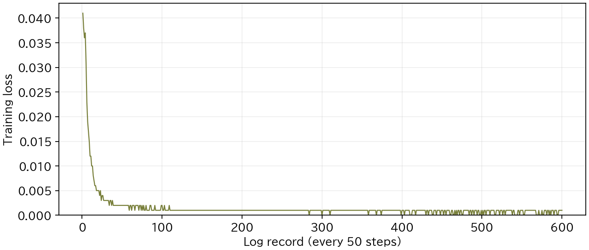

# LoRAによるペン収納の追加学習

SO-101向けπ0.5の `dongyoonkim/so101-pi05-base` に、自作の教師データでLoRAによる模倣学習を行いました。ベースの重みを固定し、LoRAの重みだけを更新しました。提出したLoRAと入出力の正規化統計は `models/pen_lora/` に収録しています。

## 教師データ

ペン収納タスクと教師データの生成コードはCodexを用いて作成しました。MuJoCo内の物体位置と逆運動学から把持・収納の関節指令を計算し、上方・手首カメラの画像、６関節の状態、関節指令、タスク指示を記録しました。このうち、映像欠損のない成功55試行・99,000フレームを学習に使用しました。

当初はLeRobot v3形式で収集していましたが、その後に採用した学習コードがv2.1形式を前提としていたため、学習前に変換しました。データ本体の代わりに、[生成・選別・変換・検査のコード](../teacher/README.md)を収録しています。

## 学習条件

学習にはVLASHのSO-101向け実装を使用しました。学習設定は [configs/pen_lora.json](configs/pen_lora.json) に、Python 3.10環境の依存関係は `pixi.lock` に記録しました。

| 項目 | 設定 |
| --- | --- |
| 学習対象 | LoRAの重み。ベースの重みは固定 |
| LoRA | rank 16、alpha 16、dropout 0 |
| バッチサイズ | ８ |
| 学習ステップ数 | 30,000 |
| 最適化 | AdamW、最大学習率0.00005 |
| 学習率 | 1,000ステップのウォームアップ後、cosineで減衰 |
| 乱数seed | 1000 |

訓練用49試行・検証用６試行に分ける設定を作成しましたが、実際の読み込みには分割が反映されず、両方に全55試行が読み込まれました。そのため、独立した検証データによる学習時評価は得られていません。収録した学習コードにも、この分割の問題が残っています。

## 学習結果

50ステップごとの学習ログ600件を保存しました。訓練lossは最初の記録で0.041、最後で0.001でした。



横軸は50ステップごとのログ記録番号を示します。図とCSVの数値は元ログの丸め値であり、独立した検証データでのlossではありません。学習後の収納性能は、教師データ収集とは別のseedによる10配置で評価しました（[評価結果](../README.md#実験結果)）。

| 記録 | 内容 |
| --- | --- |
| [学習指標](../docs/results/training_metrics.csv) | step表記、loss、勾配ノルム、学習率、処理時間 |
| [学習記録](../docs/results/training_run.json) | データ選別記録と、ベースモデル・LoRA・正規化統計のハッシュ |
| [環境記録](../docs/results/training_environment.json) | 使用パッケージのバージョン、外部ソースのコミット |

## 再学習の実行方法

[教師データの生成](../teacher/README.md)で作成する `teacher/outputs/pen_dataset/` と、[ルートREADMEのセットアップ](../README.md#セットアップ)で取得するベースモデル・トークナイザを使用します。

以下は、ホスト側のリポジトリ直下で実行するコマンドです。

```bash
docker compose --profile training build training
docker compose --profile training run --rm training pixi install --locked
docker compose --profile training run --rm training bash scripts/train.sh
```

`train.sh` はデータ形式・試行数・フレーム数を検査し、VLASHの `train.py` を実行します。学習結果は `training/outputs/pen_lora/` に保存します。既存の出力先では停止するため、再実行時は設定の `output_dir` を未使用の保存先に変更します。

30,000ステップ後の重みと正規化統計の保存先は、次のとおりです。

```text
training/outputs/pen_lora/checkpoints/030000/pretrained_model/
  config.json
  normalize_buffers.pt
  lora_adapters/adapter_config.json
  lora_adapters/adapter_model.safetensors
```

## 再学習したモデルの検証

ROSパッケージのビルド後、ホスト側のリポジトリ直下で次を実行すると、重みと正規化統計の読み込みを検査できます。

```bash
docker compose run --rm ros2 bash -c '
source /workspace/ros2_ws/install/setup.bash
ros2 run so101_policy check_model --adapter /workspace/training/outputs/pen_lora/checkpoints/030000/pretrained_model
'
```

収納性能の評価には、[ルートREADMEの実行方法](../README.md#実行方法)で起動するシミュレータを使用します。次のコマンドは、別のターミナルのコンテナ内で実行します。

```bash
cd /workspace
export POLICY_ADAPTER=/workspace/training/outputs/pen_lora/checkpoints/030000/pretrained_model
export EVAL_OUTPUT=/workspace/outputs/retrained_comparison
export REALTIME_OUTPUT=/workspace/outputs/retrained_continuous
bash scripts/run_evaluation.sh base
bash scripts/run_evaluation.sh lora
python scripts/summarize_evaluation.py "$EVAL_OUTPUT"
for seed in {7100..7109}; do
  bash scripts/run_realtime_trial.sh "$seed" || break
done
python scripts/summarize_realtime.py --paused "$EVAL_OUTPUT/lora" --continuous "$REALTIME_OUTPUT"
```

`POLICY_ADAPTER` は評価するLoRAと正規化統計の保存先を指定します。ベースモデルの評価にも、この正規化統計を共通して使用します。
